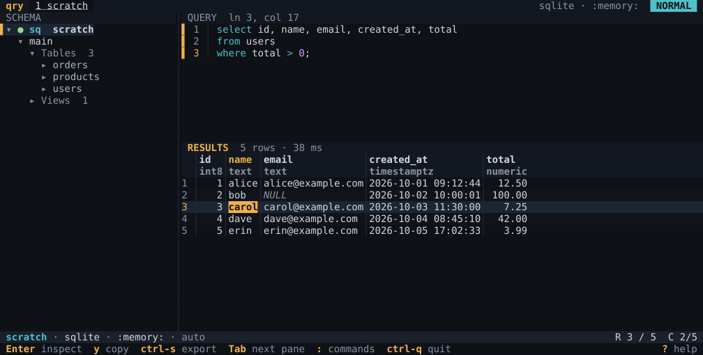

# qry

[](https://github.com/viperh/qry/actions/workflows/ci.yml)
[](https://github.com/viperh/qry/releases)
[](LICENSE)
[](Cargo.toml)

A fast, keyboard-driven terminal SQL client for PostgreSQL, MySQL, MariaDB,
SQLite and Oracle.



## Features

- **Schema browser**: connections, schemas, tables, views, columns (with
  primary and foreign keys) and indexes, loaded as you open them, with a
  filter.
- **SQL editor** with highlighting per dialect; `ctrl-Enter` runs the
  statement under the cursor, F8 runs them all, and a failed statement is
  marked where the server stopped.
- **Result grid** with typed columns, one tab per statement, sorting on
  several columns, incremental search, column resizing, a frozen first
  column and copying as CSV, TSV, JSON, Markdown or SQL `INSERT`s.
- **Inspector**: the selected record, a column's profile, and a popup for
  long values (JSON pretty-printed, binaries as hex).
- **Jobs**: a spinner and timer while a statement runs, `ctrl-c` to cancel
  it on the server, a row limit, and a drawer (`J`) listing what ran.
- **Transactions**: a `TX` pill while one is open, Commit and Rollback in
  the palette, and a question before quitting with one open.
- **History and snippets**: every statement per connection (`ctrl-r`),
  with passwords redacted, and named snippets.
- **Exports** of a result to a file.
- **Several sessions** at once, each with its own connection, editor and
  results.
- **Passwords** in the OS keychain, an environment variable or a prompt;
  never in qry's files.
- **Import** connections from DBeaver and Oracle SQL Developer.
- A **command palette** (`ctrl-p`), a **help** overlay (`?`, F1) built from
  your key bindings, and **NO_COLOR** support.

## Install

| Channel | Command |
| --- | --- |
| Prebuilt binaries | [GitHub releases](https://github.com/viperh/qry/releases): Linux (static, x86_64 and aarch64), macOS (universal), Windows |
| Cargo | `cargo install qry --locked` |
| Arch Linux (AUR) | `yay -S qry-bin`, or `qry` to build from source |
| Homebrew | `brew install viperh/tap/qry` |
| Scoop | `scoop bucket add viperh https://github.com/viperh/scoop-bucket` then `scoop install qry` |
| Nix | `nix run github:viperh/qry` |

Release archives include the man page (`qry.1`) and completions for bash,
zsh, fish and PowerShell; `qry generate man` and
`qry generate completions <shell>` print them too.

## Quick start

```sh
qry
```

qry opens on a scratch in-memory SQLite database, so you can type SQL at
once:

- `Tab` moves between the tree, the editor and the results.
- `ctrl-Enter` (or F5) runs the statement under the cursor.
- `ctrl-n` adds a connection; Enter on it in the tree connects.
- `ctrl-p` opens the command palette, `?` the help, `ctrl-q` quits.

Every key is listed in [docs/keybindings.md](docs/keybindings.md).

## Configuration

qry layers a user config (`config.json5`, `config.json`, `config.yaml`,
`config.toml` or `config.ini`) over its built-in defaults. It is read from
`$QRY_CONFIG`, else the platform's config directory; `qry --version` prints
the directories, and `qry --print-config` the config in effect. A file only
needs what it changes:

```json5
{
  "theme": "dark",
  "max_rows": 5000,
  "keybindings": { "Editor": { "<alt-r>": "RunStatement" } }
}
```

`QRY_DATA` moves the data directory (connections, history, the log) and
`QRY_LOG_LEVEL` sets the log's level. Every key is in
[docs/config.md](docs/config.md).

## Security

- Passwords live only in the OS keychain, an environment variable, or are
  asked for at connect. They are never written to `connections.json`, the
  history, the log or an export, and never imported from other tools.
- The history replaces the string after words such as `PASSWORD` and
  `IDENTIFIED BY` with `'•••'` (config `history.redact`).
- A connection labelled `prod` asks before the first write of each session.

More in [docs/connections.md](docs/connections.md).

## Documentation

- [Key bindings](docs/keybindings.md) and [configuration](docs/config.md)
- [Connections and passwords](docs/connections.md)
- [Theme and terminals](docs/theme.md)
- [Architecture](docs/architecture.md) and [testing](docs/testing.md)
- [Contributing](CONTRIBUTING.md), [changelog](CHANGELOG.md) and the
  [release checklist](docs/release.md)

## License

MIT; see [LICENSE](LICENSE).
